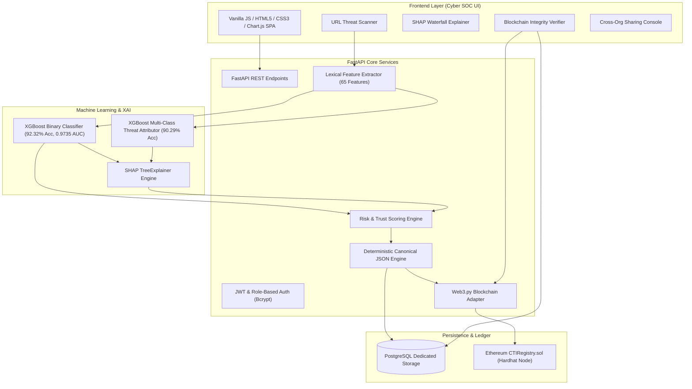
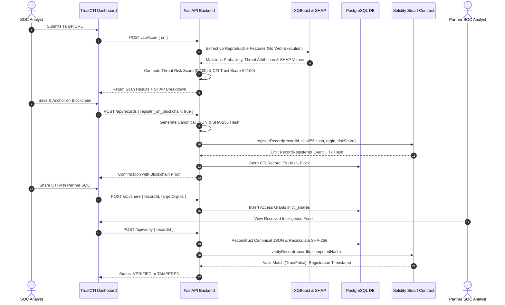

# TrustCTI
### Explainable AI and Blockchain-Based Trustworthy Cyber Threat Intelligence Sharing Platform

TrustCTI is a production-grade, decentralized Cyber Threat Intelligence (CTI) web platform that combines **Explainable Machine Learning (XGBoost + SHAP)** with **Ethereum Smart Contracts (Solidity + Web3.py)** to identify malicious URLs, explain model decisions, assess multi-dimensional threat risk and intelligence trust, and guarantee cryptographic non-repudiation and tamper-evident sharing across federated Security Operations Centers (SOCs).

---

## 1. System Architecture



---

## 2. Complete End-to-End Workflow



---

## 3. Technology Stack

- **Frontend**: HTML5, Modern Cyber Dark CSS3, Vanilla ES6+ JavaScript, Chart.js 4.4.
- **Backend**: Python 3.13+, FastAPI, Pydantic v2, SQLAlchemy 2.0, Uvicorn.
- **Machine Learning**: Pandas, NumPy, Scikit-learn, XGBoost (Histogram gradient boosting), SHAP (TreeExplainer), Joblib.
- **Database**: PostgreSQL (Production Dedicated Engine via `psycopg` driver).
- **Blockchain**: Solidity 0.8.20, Hardhat local Ethereum node, Web3.py 6.x.
- **Security**: SHA-256 cryptographic hashing, direct Bcrypt password hashing, HS256 JWT sessions, Organization-level RBAC.

---

## 4. Dataset Analysis & Leakage Resolution

The application was trained directly on `data/cti_binary_dataset.csv` (632,844 rows, 89 columns, 206.6 MB).

### Class Distribution
- **Benign**: 422,241 (66.72%)
- **Defacement**: 95,285 (15.06%)
- **Phishing**: 91,741 (14.50%)
- **Malware**: 23,577 (3.73%)
- **Total Malicious**: 210,603 (33.28%)

### Critical Leakage Diagnosis
During programmatic feature analysis, two categories of columns were identified that **must not be used**:
1. **Website-Dependent Features (`web_*`)**: `web_http_status`, `web_is_live`, `web_csp`, `web_favicon`, etc. Over 93.7% of URLs in the dataset were offline or had 0 values. Furthermore, **security analysts must never browse or execute malicious URLs** during triage.
2. **Dataset-Level Synthetic Leakage**:
   - `abnormal_url`: Had a synthetic correlation of -0.718 with `is_malicious` caused by merging heterogeneous datasets. It cannot be extracted from a raw URL.
   - `//`: Counted double slashes arbitrarily in third-party source slices rather than actual characters in the URL string.
   - `is_syntax_valid`: Contained zero variance (1.0 across all rows).

**Resolution**: All leaked and web-dependent columns were formally removed. The model was trained on **65 purely reproducible lexical, structural, and heuristic features** derived strictly from URL parsing.

### Final Model Evaluation Metrics (Tested on 126,569 Unseen Records)
- **Accuracy**: **92.32%**
- **Precision**: **88.85%**
- **Recall**: **87.98%**
- **F1-Score**: **88.41%**
- **ROC-AUC**: **0.9735**
- **Confusion Matrix**: `[[79796, 4652], [5063, 37058]]`
- **Multi-Class Threat Categorization Accuracy**: **90.29%**

---

## 5. Explainable AI (SHAP) Attribution

TrustCTI integrates game-theoretic SHAP TreeExplainer. For every URL analysis, SHAP computes exact local attributions:
- **Positive SHAP Values (+)**: Features pushing the model decision toward **Malicious**.
- **Negative SHAP Values (-)**: Features mitigating danger and pushing toward **Benign**.

### Top Global Influential Features:
1. `url_len`: Overall character count of the URL payload.
2. `url_len_v2`: Normalized URL length.
3. `phish_long_path`: Path length exceeding 30 characters.
4. `path_len`: Total length of the URL path component.
5. `letter_count_v2`: Frequency of alphabetic characters.
6. `phish_adv_hyphen_count`: Domain hyphenation (typosquatting).
7. `url_entropy`: Shannon entropy measuring token obfuscation.

---

## 6. Scoring Framework

### A. Threat Risk Score (0 - 100)
Represents **how dangerous the analyzed indicator appears to be**.
$$\text{BaseRisk} = P(\text{Malicious}) \times 60$$
$$\text{ThreatRiskScore} = \min(100, \max(0, \text{round}(\text{BaseRisk} + \sum \text{HeuristicWeights})))$$
- Direct IP Host: $+10$ pts
- Suspicious TLD (.xyz, .top, .tk): $+8$ pts
- Brand Spoofing / Hijacking: $+8$ pts
- Payload Extension (.exe, .sh, .apk): $+7$ pts
- High Shannon Entropy ($> 4.5$): $+4$ pts
- Credential Harvesting Keywords: $+2$ to $+5$ pts

### B. CTI Trust Score (0 - 100)
Represents **the verifiable authenticity and pedigree of the intelligence report**.
$$\text{TrustScore} = 0.35 \cdot C_{\text{pred}} + 0.25 \cdot R_{\text{source}} + 0.25 \cdot H_{\text{blockchain}} + 0.15 \cdot I_{\text{features}}$$
- $C_{\text{pred}}$ (35%): Distance of model certainty from uncertainty ($|P - 0.5| \times 200$).
- $R_{\text{source}}$ (25%): Submitting organization baseline reputation (e.g. US-CERT = 98).
- $H_{\text{blockchain}}$ (25%): Cryptographic ledger status ($100$ if verified, $0$ if tampered).
- $I_{\text{features}}$ (15%): Feature completeness ($100$ for clean lexical extraction).

---

## 7. Smart Contract Architecture

The Solidity smart contract `CTIRegistry.sol` deployed at `0x5FbDB2315678afecb367f032d93F642f64180aa3`:
- Stores `bytes32` SHA-256 canonical record hashes.
- Records submitting organization, threat classification, risk score, and block timestamp.
- Emits `RecordRegistered` events for decentralized listening.
- Exposes `verifyRecord(recordId, computedHash)` view function to confirm integrity without gas fees.
- **Never stores sensitive intelligence, URLs, or PII on-chain.**

---

## 8. Installation & Setup (Windows PowerShell)

### Prerequisites
- Python 3.11 - 3.13
- Node.js v18+ and npm
- Git

### Step 1: Install Python Dependencies
```powershell
python -m pip install -r requirements.txt
```

### Step 2: Install Blockchain Dependencies & Compile Smart Contract
```powershell
cd blockchain
npm install
npx hardhat compile
cd ..
```

### Step 3: Run Unit & Integration Test Suites
```powershell
# Run Smart Contract Mocha Tests (5 passing)
cd blockchain
npx hardhat test
cd ..

# Run Backend & Workflow Pytest Suite (18 passing)
python -m pytest tests/ -v
```

---

## 9. Running the Application

### Option A: Local Development (Recommended)

**Terminal 1 (Start Local Ethereum RPC Node):**
```powershell
cd blockchain
npx hardhat node
```

**Terminal 2 (Deploy Smart Contract):**
```powershell
cd blockchain
npx hardhat run scripts/deploy.js --network localhost
cd ..
```

**Terminal 3 (Seed Initial Data & Start FastAPI Server):**
```powershell
python -m backend.seed
python -m uvicorn backend.main:app --reload --host 127.0.0.1 --port 8000
```

Open your browser at:
`http://127.0.0.1:8000/`

### Demo Credentials
| Organization | Username | Password | Role |
| :--- | :--- | :--- | :--- |
| **US-CERT Defense Network** | `cert_admin` | `TrustCTI@2026!` | Admin |
| **FinSOC Global Alliance** | `fin_analyst` | `TrustCTI@2026!` | Analyst |
| **Critical Infrastructure ISAC** | `isac_member` | `TrustCTI@2026!` | Analyst |

---

## 10. Demonstration of Complete Workflow

1. **Sign In**: Navigate to `http://127.0.0.1:8000/` and log in with `cert_admin`.
2. **Scan URL**: Go to **URL Scanner**, enter `http://br-icloud.com.br` or click the test pill.
3. **Inspect Predictions & SHAP**: View the **Threat Risk Score** (68/100), **CTI Trust Score**, and the **SHAP Waterfall attribution** showing why it was classified as Phishing.
4. **Anchor on Blockchain**: Click **Save & Anchor on Blockchain**. The backend creates a canonical JSON representation, computes its SHA-256 hash, and calls `CTIRegistry.sol` on the local node.
5. **View On-Chain Ledger**: Navigate to **On-Chain History** to see the transaction hash, gas used, and block number.
6. **Share Intelligence**: Go to **Share Intelligence**, select the record, choose **FinSOC**, and transmit.
7. **Verify & Tamper Test**:
   - Go to **Integrity Verifier**, select the record, and click **Execute Cryptographic Verification** $\rightarrow$ Status: `VERIFIED`.
   - In the **Interactive Tamper Simulation Test**, alter the classification in the canonical JSON text box from `"Malicious"` to `"Benign"` and click **Test Tampered Hash** $\rightarrow$ Status: `TAMPERED` (Hash mismatch flagged instantly).

